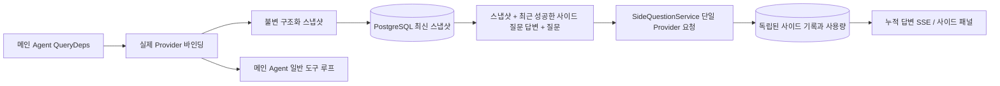

# ARTEX `/btw`

일반 채팅, 작업의 MainAgent, 그리고 현재 작업 자체의 Worker는 독립적인 사이드 질문을 지원한다. 메인 입력창에 `/btw 질문`을 입력하면 제출되며, 빈 `/btw` 또는 "사이드 질문" 버튼은 기록을 연다. 데스크톱에서는 너비를 조절할 수 있는 사이드바를, 모바일에서는 Drawer를 사용한다.

사이드 답변은 제출 시점의 Agent 컨텍스트 스냅샷을 기반으로 생성되며, 스트리밍 표시, 추가 질문, 중지, 비우기를 지원한다. 패널을 닫거나, 페이지를 새로 고치거나, SSE 연결이 끊겨도 모델 요청은 취소되지 않는다. 중지는 현재 사이드 질문에만 영향을 주며, 비우기는 사이드 질문을 취소하고 사이드 기록을 삭제하되 메인 컨텍스트 스냅샷은 유지한다.

## 구현 경계

기존의 Go, norma v0.3.7, Next.js, 그리고 현재의 Markdown / ResizablePanel / Drawer / AlertDialog 컴포넌트를 그대로 쓴다; norma 소스를 수정하거나 사이드 질문을 위해 의존성을 추가하지 않았다. Planner, 다른 작업에서 상속된 Worker, 도구형 하위 작업 업그레이드는 이번 범위에 포함되지 않는다.

- `capture.go`는 `Options.Deps.CallModel / CallModelSync`에서만 메인 루프 요청을 표시한다. Provider 데코레이터는 구체적인 모델 내부, 라우팅 풀의 바깥쪽 선택 이후에 위치하므로 실제로 선택된 모델을 기록한다; 압축 및 요약 요청은 스냅샷을 덮어쓰지 않는다.
- 요청 시작, 완전한 모델 응답, 실행 종료 상태에서 스냅샷을 게시한다. 생성 중인 반쪽짜리 응답은 게시하지 않는다; 도구 호출은 norma의 `MessagesForAPI`로 짝을 유지하며, 도구 결과는 다음 메인 모델 요청 또는 실행 종료 상태에서 스냅샷에 들어간다. 스트리밍이 중단되면 직전의 유효한 경계를 유지한다.
- 스냅샷은 JSON 깊은 복사로 구조화된 메시지, 시스템 프롬프트, 도구 정의, 생성 파라미터를 보존한다. 모델 추론은 스냅샷 잠금이나 데이터베이스 트랜잭션을 잡지 않는다.
- `SideQuestionService`는 구체적인 Provider를 호출한다; 필요하면 먼저 사이드 요약을 생성하며, 최종 답변은 처음 컨텍스트가 초과되었고 아직 텍스트/도구 호출을 출력하지 않은 경우에만 줄여서 한 번 재시도할 수 있다. agent 세션을 만들지 않고, 도구 실행기, 메인 transcript, 활동 스트림, 작업 그래프에 연결하지 않으며, 작업 모델 전환 체인도 거치지 않는다. 답변 요청이 도구 정의를 유지하는 것은 기존의 구조화된 도구 컨텍스트와 호환되도록 하기 위해서이며, 요약 요청에는 도구를 제공하지 않는다. 새로 반환된 도구 호출에는 실행 경로가 없다.
- 부모 세션당 실행 중인 요청은 하나, 단일 서비스 프로세스당 최대 네 개이며, 한 번의 타임아웃은 120초다. 사이드 질문은 서비스 수명 주기 아래의 독립된 취소 컨텍스트를 사용한다.
- 사이드 요청은 모델 설정 참조와 민감하지 않은 신원 요약을 유지한다; 자격증명은 요청 시점에 기존 설정에서 가져온다. 설정이 삭제되거나 모델, 프로토콜, 주소 등 신원 필드가 바뀌면 먼저 메인 Agent를 실행해 스냅샷을 갱신해야 한다. 테스트는 제품의 기본 모델을 바꾸지 않는다.

## 영속화와 복구

`db/schema.sql`이 `side_question_sessions`와 `side_question_requests`를 자동으로 만든다. 전자는 부모 리소스, 최신 스냅샷, 실행 번호, 버전, 정리 버전을 저장하고, 후자는 질문, 누적 답변, 상태, 모델, 스냅샷 시각, 사용량, 이벤트 일련번호, 페이지 일련번호를 저장한다.

부모 세션 키는 conversation ID, 또는 task ID + exploration ID + intent ID를 쓴다. Worker는 재사용 가능한 실행 슬롯 이름을 사용하지 않는다.

스냅샷은 부모 세션 단위로 병합해 기록하며 250 ms마다 갱신되고, 데이터베이스가 `(run_id, version)`을 비교해 오래된 버전이 덮어쓰는 것을 막는다. 사이드 질문을 제출하기 전에 선택된 스냅샷을 한 번 더 저장한다. 저장에 성공하면 메모리의 큰 스냅샷을 해제하고, 실패하면 기록 대기 버전을 유지한다. 답변 누적 내용은 스트리밍 이벤트가 올 때 최대 250 ms마다 한 번 기록하며, 종료 상태는 즉시 저장하고 데이터베이스 오류 시 제한적으로 재시도한다.

서비스가 시작되면 남아 있던 `running` 요청을 `interrupted`로 표시하고, 이미 저장된 부분 답변과 사용량을 보존하며 요청을 자동으로 재실행하지 않는다. 가장 최근에 성공적으로 저장된 컨텍스트는 다음 질문에 바로 쓸 수 있다. 스냅샷이 없는 오래된 세션은 먼저 메인 Agent를 실행해야 하며, UI 활동 기록에서 컨텍스트를 재구성하지 않는다.

비우기 작업은 정리 버전을 올리고 요청을 삭제한다; 조건부 갱신이 늦게 도착한 콜백이 다시 기록하는 것을 막는다. 물리적인 부모 리소스 삭제는 외래 키 연쇄에 의존하고, Worker의 논리 삭제는 같은 트랜잭션에서 사이드 데이터를 삭제하며 이후 늦게 도착한 스냅샷을 거부한다. 작업 아카이브는 먼저 새 요청을 막고, 메인 흐름이 멈출 때까지 기다린 뒤, 사이드 질문을 취소하고 저장이 끝나기를 기다린다; 아카이브 형식은 v3이며, 사이드 테이블이 없는 v1/v2와도 호환된다.

기록은 전부 보존하며, 일련번호 커서로 페이지당 최대 20건을 반환한다. 모델 요청은 최근 성공한 질의응답 최대 20쌍의 원문을 재생하되, 재생량도 token 예산으로 제한한다; 더 오래된 질의응답은 독립적인 롤링 요약으로 관리한다. 메인 컨텍스트가 예산을 넘으면 사이드 사본의 오래된 부분만 요약하고, 최근의 구조화된 도구 호출과 결과는 유지한다. 요약, 준비 진행 상황, 사용량은 사이드 질문의 동시성, 취소, 120초 타임아웃 제한에 함께 포함된다. 자세한 내용은 [컨텍스트 예산과 오픈소스 참고](CONTEXT_BUDGET.md) 참고.

## HTTP 계약

아래 경로를 `{parent}`로 하며, 기존의 인증과 리소스 검증을 그대로 따른다:

- `/api/conversations/{id}`
- `/api/tasks/{id}/chat`
- `/api/tasks/{id}/intents/{iid}`

| 요청 | 반환 및 동작 |
| --- | --- |
| `GET {parent}/side-questions?before={ordinal}` | `items`는 최신순에서 오래된 순으로 정렬되고, 독립된 `current` 실행 상태, `snapshot` 메타 정보, `next_cursor`를 반환한다; 커서가 0이면 최신 페이지 / 다음 페이지 없음을 뜻한다 |
| `POST {parent}/side-questions` | JSON `{ "question": "…", "client_request_id": "UUID" }`; 새 요청은 202와 요청 객체를 반환하고, 같은 ID와 같은 질문이면 기존 객체를 200으로 반환한다 |
| `DELETE {parent}/side-questions` | 현재 부모 세션의 사이드 질문 답변을 취소하고 비운다 |
| `GET /api/side-questions/{requestID}/events` | `snapshot` SSE 이벤트이며, `id`는 증가하는 일련번호, `data`는 완전한 누적 요청 객체다; 비울 때는 `cleared`를 보낸다 |
| `POST /api/side-questions/{requestID}/cancel` | 명시적 취소; 종료 상태는 기록이나 SSE에서 읽을 수 있다 |

질문 상한은 4000자다. 스냅샷이 없거나, 모델 설정이 바뀌었거나, 같은 부모 세션이 사용 중이거나, 멱등 ID가 충돌하면 409를 반환하고, 전역 동시성 상한에 걸리면 429를 반환한다. SSE 연결은 매번 누적 상태를 먼저 보내며, 클라이언트가 이전에 받은 텍스트 조각에 의존하지 않는다. 프런트엔드는 요청 ID + 일련번호로 병합하고, 부모 세션을 바꾸거나 비울 때 오래된 콜백을 폐기한다.

## 검증과 참고

자동화 검사, 실제 모델 사용 및 알려진 제한 사항은 [VALIDATION.md](VALIDATION.md)를 참고한다.

독립 요청은 [Grok CLI side-question.ts(고정된 커밋)](https://github.com/superagent-ai/grok-cli/blob/fb97af83f06dca873281d60168430f06c8de6324/src/utils/side-question.ts)를, 실행 격리는 [OpenCode(고정된 커밋)](https://github.com/anomalyco/opencode/tree/b3f1a96c6dd7adeb28b36dd11add1998fc84d67b)를 참고했다. ARTEX의 컨텍스트는 norma의 구조화된 메시지를 사용하며, 프런트엔드 로그에서 텍스트를 이어 붙이는 방식은 채택하지 않았다.
